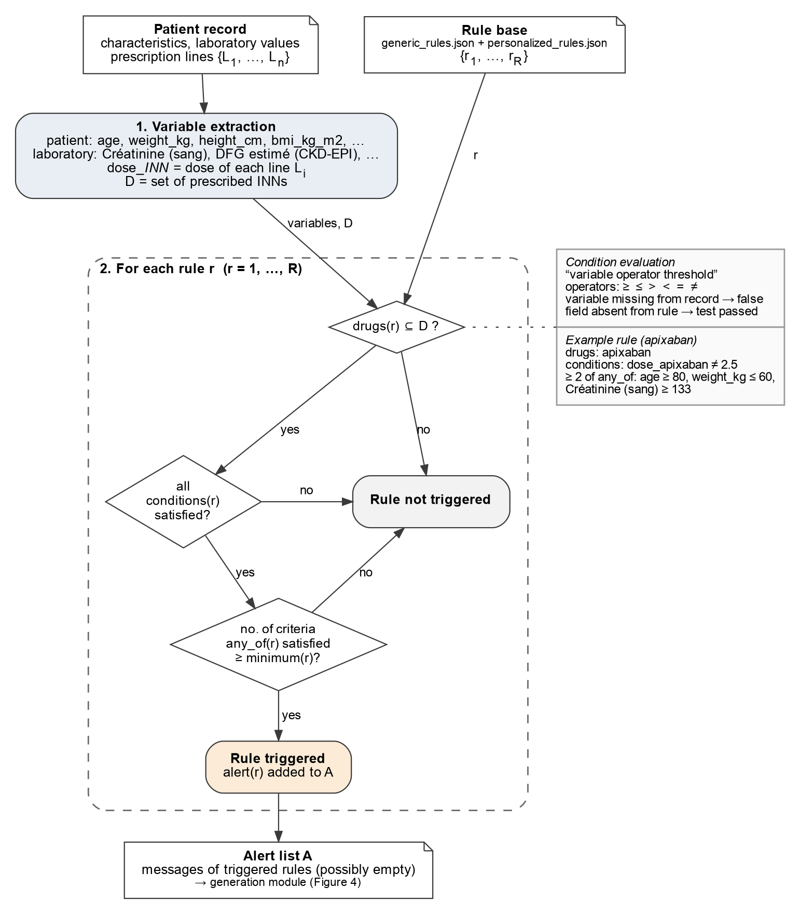

# AI-assisted pharmaceutical analysis software

Pipeline that analyses hospital prescriptions by combining a Knowledge-Based System (KBS), a retrieval module over
clinical guidelines (RAG) and a large language model (LLM).

**Demo:** https://projetpui.streamlit.app/ (Streamlit Community Cloud, fictitious patients). Changes made in the
demo (analyses, rules, uploaded documents) are not kept when the app restarts.

## Installation

```bash
pip install -r requirements.txt
```

Create a `.env` file at the project root:

```
OPENROUTER_API_KEY=your_key
```

All commands below are run from the project root.

---

## Backend: analysis pipeline

### Architecture


**Figure 1. Overall architecture of the AI-assisted pharmaceutical analysis pipeline.**
Guidelines (PDF) are split into passages and indexed in a vector database (ChromaDB).
For each patient, the orchestration module queries in parallel the retrieval module, which extracts the relevant passages, and the Knowledge-Based System (KBS), which produces deterministic alerts; both outputs are passed to the language model, which gives the final decision.

The indexing must be run before the first analysis (see [Indexing](#indexing)).

### Scripts

| Script | Role |
|---|---|
| `main.py` | Analyses the patients of a folder with the KBS, the RAG and the LLM, and saves the results |
| `indexing.py` | Indexes the guidelines (PDF) in a vector database (ChromaDB) |
| `retrieval.py` | Searches the vector database for the passages useful for a patient |
| `kbs.py` | Knowledge-Based System (KBS): applies the deterministic rules; has the LLM draft a new rule |
| `generation.py` | Analyses a patient with the LLM |

### Full pipeline

```bash
python3 main.py --remaining   # patients without a result (or whose analysis failed)
python3 main.py --all         # all patients: the results file is overwritten
```

The folder is `dataset` by default; use `--folder full_dataset` to analyse the full dataset.

Each result is saved in `inference_results.json` as soon as the patient is analysed: the decision (`PATIENT VALIDATED`, `MONITORING PROPOSED`, `VERIFICATION PROPOSED` or `PHARMACEUTICAL INTERVENTION PROPOSED`), the typed points with their sources, the KBS alerts and the date. An error is stored in the result of the patient instead of stopping the run.

### Indexing

Run once, then each time a PDF is added to `ressources/rag/RAG_Docs/`:

```bash
python3 indexing.py
```

Prints the number of passages indexed per PDF and creates the `ressources/rag/chroma_db/` folder. Re-indexing a PDF replaces its passages (those of a previous version are deleted).

### Retrieval (RAG)


**Figure 2. Retrieval of the relevant guideline excerpts for a patient (Retrieval-Augmented Generation).**
Laboratory parameters outside their reference ranges are converted into textual descriptors and added to the patient profile. A query is built for each prescription line (drug label, dosage regimen, patient profile), encoded with Qwen3-Embedding-8B, then submitted to a 3-nearest-neighbour search (cosine distance). The retrieved passages are deduplicated and sorted by distance, and the 8 closest form the context passed to the language model.

```bash
python3 retrieval.py --folder dataset --patient-id 100133744
```

Prints the most relevant passages for the patient, with their PDF and page.

### Knowledge-Based System (KBS)



**Figure 3. Operation of the Knowledge-Based System (KBS) made of deterministic rules.**
Patient variables (characteristics, laboratory values, dose of each drug) are extracted from the record. Each rule is triggered if (i) all the drugs it targets are prescribed, (ii) all its mandatory conditions are met and (iii) a minimum number of optional criteria is satisfied. The messages of the triggered rules form the list of alerts passed to the language model.

```bash
python3 kbs.py --folder dataset --patient-id 100133744
```

Prints the detected alerts, or `No alert`.

The rules are in `ressources/kbs/generic_rules.json` (ANSM Thesaurus, DDI-Predictor) and `ressources/kbs/personalized_rules.json` (hospital rules). The texts of the generic rules are kept in French, as in the source documents. A rule is triggered if all its fields are satisfied:

| Field | Meaning |
|---|---|
| `drugs` | all these drugs (INN) are prescribed, on different lines: the name is searched in the label of each prescription line, ignoring case and accents. An item can be a list of INNs, any one of which is enough (Thesaurus class) |
| `conditions` | all these conditions are true |
| `any_of` + `minimum` | at least `minimum` of these conditions are true |
| `alert` | message displayed when the rule is triggered |

Only `alert` is required. A condition is written `variable operator value`, for example `age >= 80`, with the operators `>=`, `<=`, `>`, `<`, `==`, `!=`.
The usable variables are the patient fields (`age`, `weight_kg`, `height_cm`, `bmi_kg_m2`, `body_surface_area_m2`), the laboratory values with the exact parameter name (`Créatinine (sang)`, `DFG estimé (CKD-EPI)`...) and, for the drugs named in the rule, the product strength (`dose_apixaban`), the prescribed dose in mg per day (`daily_dose_daptomycine`) and in mg/kg per day (`dose_per_kg_daptomycine`).

To have the LLM draft a personalized rule (it is displayed, then saved after confirmation):

```bash
python3 kbs.py --folder dataset --new-rule "Alert if metformin with an eGFR < 30 mL/min"
```

### Generation (LLM)


**Figure 4. Generation of the pharmaceutical opinion by the language model.**
The message submitted to the model (Qwen3.6-35B-A3B, temperature 0, constrained JSON output) combines the patient record (lines numbered L1, L2..., status of each line on the reference date, daily dose computed by the code, abnormal laboratory values flagged, drugs present on several lines with their total dose), the KBS alerts (numbered [A1], [A2]...) and the retrieved guideline excerpts (numbered [R1], [R2]...). The system prompt defines the clinical pharmacist role, the analysis criteria and the ranking of the alerts (contraindications first). The response is a JSON object containing the decision (patient validated, monitoring proposed, verification proposed or pharmaceutical intervention proposed) and 1 to 4 typed points (intervention, verification, monitoring, validation) written as proposals (“We propose…”, “We suggest…”), each with the identifiers of the alerts and excerpts it relies on. Identifiers that match no provided alert or excerpt are ignored. The displayed decision is that of the most severe point; for an intervention, the LLM also gives the lines to modify.

```bash
python3 generation.py --folder dataset --patient-id 100133744
```

Prints the decision and the justification (without KBS alerts or guideline excerpts: use `main.py` for the full pipeline).

---

## Frontend: Streamlit interface

### Usage

```bash
streamlit run app.py
```

The interface always works on the patients of `dataset/`; `full_dataset/` is analysed from the command line only (`python3 main.py --remaining --folder full_dataset`).
The “Lancer l'analyse” button runs `main.py --remaining` (patients without a result); results are read from `inference_results.json`. Re-analysing all the patients (`main.py --all`) is done from the command line only.


*Analysis results: for each patient, profile, laboratory values, prescription, pharmaceutical opinion, KBS alerts and clickable sources.*


*Viewing a source: clicking a reference opens the PDF at the page cited by the model.*

The interface is in French and has three pages. On the “Résultats d'analyse” page, the indicators and the “Lancer l'analyse” button are above the patient list. On the “Règles du KBS” page, the pharmacist has the LLM assistant draft a personalized rule from a natural-language request, checks it before saving, and can delete the saved rules. The “Documents du RAG” page lists the indexed guidelines (click to view), indexes the PDFs added to `ressources/rag/RAG_Docs/` and uploads new ones. Any other change (generic rules, manual editing of `ressources/kbs/personalized_rules.json`, laboratory reference ranges in `ressources/lab_reference_ranges.json`) is made directly in the files, outside the interface.

### Code

`app.py` holds what is common to every page (configuration, style, application bar) and declares the pages with
`st.navigation`. The interface code is in `ui/`, with one `page_*.py` module per page of the application (the
patient record opened from the list included): each page loads its own data and calls the backend scripts of the
project root for any processing (analysis, rules, indexing).

```
app.py                         entry point: page configuration, application bar, list of the pages
inference_results.json         analysis results saved by main.py
ui/
├── page_analysis_results.py   “Résultats d'analyse” page: indicators, “Lancer l'analyse” (main.py --remaining),
│                              patient list
├── page_patient_result.py     record opened from the list: laboratory values, prescription, pharmaceutical
│                              opinion and KBS alerts
├── page_kbs_rules.py          “Règles du KBS” page: LLM assistant (kbs.propose_rule), proposed rule, rule list
├── page_rag_documents.py      “Documents du RAG” page: indexed guidelines, indexing (indexing.index_pdf), upload;
│                              PDF viewer also opened from the sources of the opinion
├── common.py                  shared by the pages: page frame, patient records of dataset/, small helpers
└── style.css                  style of the whole interface
```

---

## Data and other files

| File | Role |
|---|---|
| `dataset/` | Inference folder (80 patients): one JSON file per patient (`<id>.json`), with laboratory values and treatments |
| `full_dataset/` | Full inference folder (1919 patients, not versioned), same format |
| `ressources/kbs/generic_rules.json` | KBS rules from the ANSM Thesaurus of drug interactions and from DDI-Predictor |
| `ressources/kbs/personalized_rules.json` | Hospital-specific KBS rules (e.g. apixaban dose, daptomycin 10 mg/kg) |
| `ressources/kbs/KBS_Docs/` | Reference documents from which the generic KBS rules were extracted (ANSM Thesaurus, DDI-Predictor) |
| `ressources/rag/RAG_Docs/` | Guidelines (PDF) used by the RAG |
| `ressources/rag/chroma_db/` | Vector database created by `indexing.py` |
| `ressources/lab_reference_ranges.json` | Reference ranges of laboratory values, used by `retrieval.py` and `generation.py` |
| `preprocessing/` | Builds the patient JSON files from the anonymised CSV extractions (`preprocessing/original_dataset/`, not versioned) |
| `paper/` | Article, presentation and figures (`paper/figures_en/`) |

### Preprocessing

Rebuilds the patient files from the CSV files of `preprocessing/original_dataset/`:

```bash
python3 preprocessing/preprocessing.py
```

Writes one JSON file per patient to `preprocessing/dataset/`. `python3 preprocessing/analysis.py` prints the number of patients kept at each filtering step.
