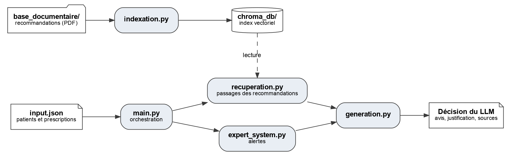
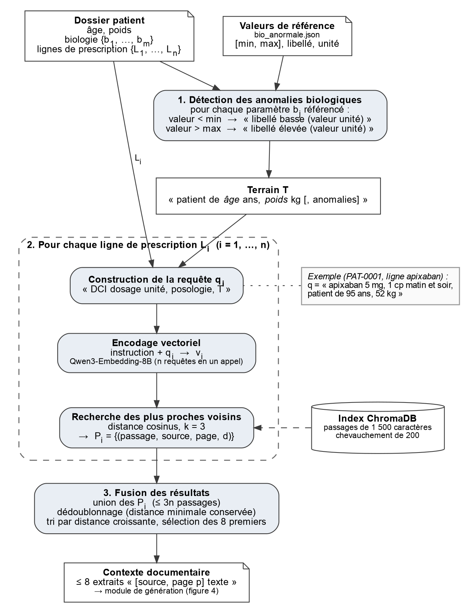
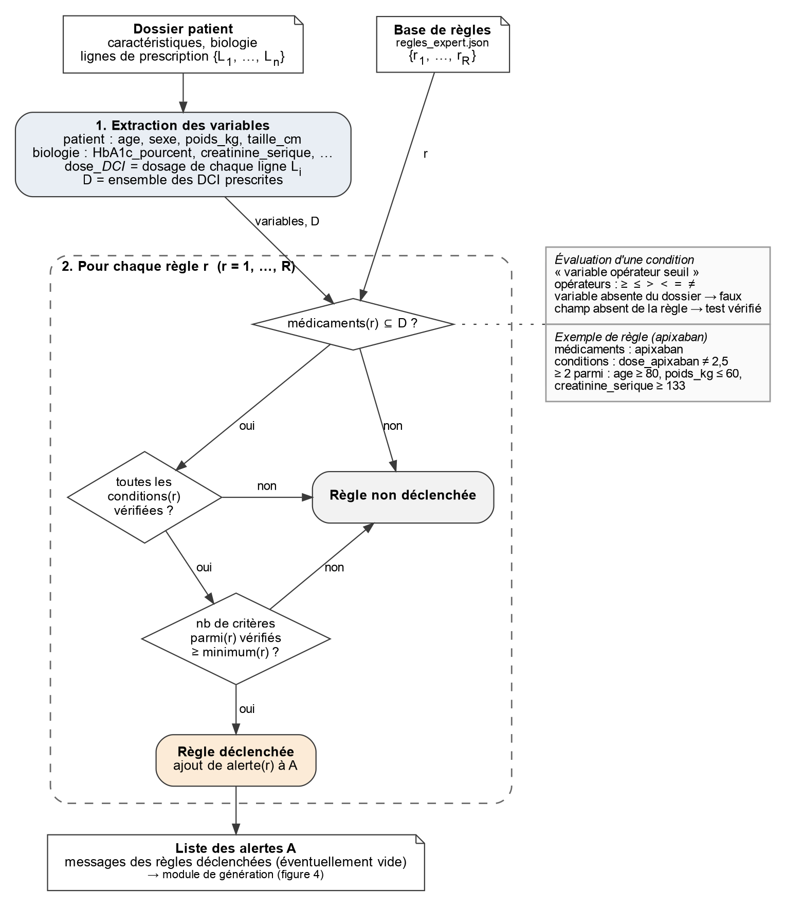
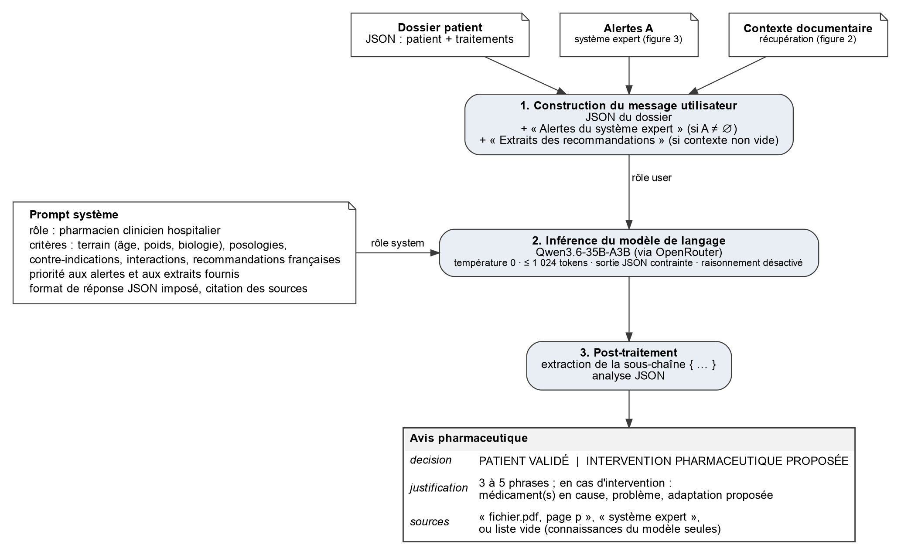

# Logiciel d'analyse pharmaceutique assistée par IA

## Installation

```bash
pip install -r requierments.txt
```

Créer un fichier `.env` à la racine du projet :

```
OPENROUTER_API_KEY=votre_cle
```

Toutes les commandes se lancent depuis la racine du projet.

## Fichiers

| Fichier | Rôle |
|---|---|
| `dataset/` | Dossier d'inférence : un fichier JSON par patient (`<id>.json`), avec sa biologie et ses traitements |
| `main.py` | Analyse tous les patients avec le LLM, le RAG et le système expert |
| `generation.py` | Analyse un patient avec le LLM |
| `expert_system.py` | Applique les règles déterministes du système expert ; fait rédiger une nouvelle règle par le LLM |
| `regles_generiques.json` | Règles issues du Thésaurus ANSM des interactions et de DDI-Predictor (`documents_systeme_expert/`) |
| `regles_personnalisees.json` | Règles propres à l'établissement (ex : dose d'apixaban, daptomycine 10 mg/kg) |
| `indexation.py` | Indexe les PDF de `base_documentaire/` dans ChromaDB |
| `recuperation.py` | Cherche dans ChromaDB les passages utiles pour un patient |
| `bio_anormale.json` | Valeurs normales de la biologie, utilisées par `recuperation.py` |
| `app.py` | Interface Streamlit (analyse, base documentaire, règles, biologie) |
| `src/` | Fonctions utilisées par `app.py` (fichiers JSON, documents, analyse) |

## Liens entre les scripts

```
base_documentaire/ --> indexation.py --> chroma_db/

                       recuperation.py   (passages des recommandations)
                     /                  \
dataset/   --> main.py                    --> generation.py --> décision du LLM
                     \                  /
                       expert_system.py  (alertes)
```

Pour chaque patient, `main.py` récupère les passages utiles avec `recuperation.py` et les alertes avec `expert_system.py`, puis les transmet à `generation.py` qui rend la décision finale.
`recuperation.py` utilise la base `chroma_db/` créée par `indexation.py` : il faut lancer `indexation.py` avant `main.py`.

## Méthodologie



**Figure 1. Architecture générale du pipeline d'analyse pharmaceutique assistée par IA.**
Les recommandations (PDF) sont découpées en passages puis indexées dans une base vectorielle (ChromaDB).
Pour chaque patient, le module d'orchestration interroge en parallèle le module de récupération, qui extrait les passages pertinents, et le système expert, qui produit des alertes déterministes ; ces deux sorties sont transmises au modèle de langage, qui rend la décision finale.



**Figure 2. Récupération des extraits de recommandations pertinents pour un patient (Retrieval-Augmented Generation).**
Les paramètres biologiques sortant des intervalles de référence sont convertis en descripteurs textuels et ajoutés au terrain du patient. Une requête est construite pour chaque ligne de prescription (DCI, dosage, posologie, terrain), encodée par Qwen3-Embedding-8B, puis soumise à une recherche des 3 plus proches voisins (distance cosinus). Les passages obtenus sont dédoublonnés, triés par distance et les 8 plus proches constituent le contexte transmis au modèle de langage.



**Figure 3. Fonctionnement du système expert à base de règles déterministes.**
Les variables du patient (caractéristiques, biologie, dose de chaque médicament) sont extraites du dossier. Chaque règle est déclenchée si (i) tous les médicaments qu'elle cible sont prescrits, (ii) toutes ses conditions obligatoires sont vérifiées et (iii) un nombre minimal de critères optionnels est satisfait. Les messages des règles déclenchées forment la liste d'alertes transmise au modèle de langage.



**Figure 4. Génération de l'avis pharmaceutique par le modèle de langage.**
Le message soumis au modèle (Qwen3.6-35B-A3B, température 0, sortie JSON contrainte) associe le dossier patient (lignes numérotées L1, L2..., statut de chaque ligne au jour de référence, dose par jour calculée par le code, biologie anormale signalée, médicaments présents sur plusieurs lignes avec leur dose totale), les alertes du système expert (numérotées [A1], [A2]...) et les extraits de recommandations récupérés (numérotés [R1], [R2]...). Le prompt système définit le rôle de pharmacien clinicien, les critères d'analyse et la hiérarchie des alertes (priorité aux contre-indications). La réponse est un objet JSON contenant la décision (patient validé, surveillance proposée, vérification proposée ou intervention pharmaceutique proposée) et 1 à 4 propositions typées (intervention, vérification, surveillance, validation) formulées comme des propositions (« Proposons… », « Suggérons… »), chacune avec les identifiants des alertes et extraits sur lesquels elle s'appuie. Les identifiants qui ne correspondent à aucune alerte ni aucun extrait fourni sont ignorés. La décision affichée est celle du point le plus grave ; pour une intervention, le LLM indique aussi les lignes à modifier, affichées en rouge dans la prescription.

## Exécution

**Interface web**

```bash
streamlit run app.py
```

Le dossier d'inférence (par défaut `dataset`) se choisit dans la barre latérale.

Les résultats des analyses sont enregistrés dans `resultats.json`.


*Résultats d'analyse : pour chaque patient, profil, biologie, prescription, avis pharmaceutique, alertes du système expert et sources cliquables.*


*Consultation d'une source : un clic sur une référence ouvre le PDF à la page citée par le modèle.*

**Tous les patients**

```bash
python3 main.py --dossier dataset
```

Affiche pour chaque patient : son identifiant, la décision (`PATIENT VALIDÉ`, `SURVEILLANCE PROPOSÉE`, `VÉRIFICATION PROPOSÉE` ou `INTERVENTION PHARMACEUTIQUE PROPOSÉE`), la justification et les sources citées par le modèle.

**Un patient avec le LLM**

```bash
python3 generation.py --dossier dataset --idpatient 100133744
```

Affiche la décision et la justification.

**Système expert**

```bash
python3 expert_system.py --dossier dataset --idpatient 100133744
```

Affiche les alertes détectées, ou `Aucune alerte`.

Les règles sont dans `regles_generiques.json` (Thésaurus ANSM, DDI-Predictor) et `regles_personnalisees.json` (règles de l'établissement). Une règle se déclenche si tous ses champs sont vérifiés :

| Champ | Signification |
|---|---|
| `medicaments` | tous ces médicaments (DCI) sont prescrits, sur des lignes différentes : le nom est cherché dans le libellé de chaque ligne de prescription, sans tenir compte des majuscules et des accents. Un élément peut être une liste de DCI dont une seule suffit (classe du Thésaurus) |
| `conditions` | toutes ces conditions sont vraies |
| `parmi` + `minimum` | au moins `minimum` de ces conditions sont vraies |
| `alerte` | message affiché quand la règle se déclenche |

Seul `alerte` est obligatoire. Une condition s'écrit `donnee operateur valeur`, par exemple `age >= 80`, avec les opérateurs `>=`, `<=`, `>`, `<`, `==`, `!=`.
Les données utilisables sont les champs du patient (`age`, `poids_kg`, `taille_cm`, `imc_kg_m2`, `surface_corporelle_m2`), ceux de sa biologie avec le nom exact du paramètre (`Créatinine (sang)`, `DFG estimé (CKD-EPI)`...) et, pour les médicaments cités dans la règle, le dosage de la spécialité (`dose_apixaban`), la dose prescrite en mg par jour (`dose_jour_daptomycine`) et en mg/kg par jour (`dose_kg_daptomycine`).

Pour faire rédiger une règle personnalisée par le LLM (elle est affichée puis enregistrée après confirmation) :

```bash
python3 expert_system.py --dossier dataset --nouvelle-regle "Alerter si metformine avec un DFG < 30 mL/min"
```

Dans l'interface, l'onglet « Règles du système expert » sépare les règles personnalisées (ajout par l'assistant ou à la main, suppression) des règles génériques (consultation et recherche).

**Indexation** (à lancer une fois, puis à chaque ajout de PDF)

```bash
python3 indexation.py
```

Affiche le nombre de passages indexés par PDF et crée le dossier `chroma_db/`.

**Récupération**

```bash
python3 recuperation.py --dossier dataset --idpatient 100133744
```

Affiche les passages les plus pertinents pour le patient, avec leur PDF et leur page.
